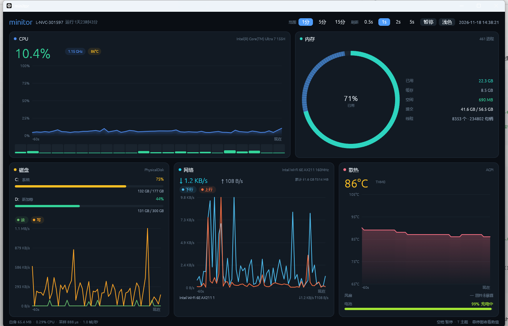

# minitor

极低开销的 Windows 资源监控：**CPU、内存、磁盘、网络、温度、风扇、电池**。两种外壳任选——终端界面（383 KB，零依赖）或图形界面（可选 egui，图表 + 交互）。

```
 minitor  L-NVC-301597  运行 1天20时31分                                                      2026-11-18 11:26:03
────────────────────────────────────────────────────────────────────────────────────────────────────────
 CPU  Intel(R) Core(TM) Ultra 7 155H  16C/22T  1.15 GHz                                              2.4%
      █▉░░░░░░░░░░░░░░░░░░░░░░░░░░░░░░░░░░░░░░░░░░░░░░░░░░░░░░░░░░░░░░░░░░░                            ▁
       0: 14%  1:  0%  2:  0%  3:  0%  4:  0%  5:  0%  6:  0%  7:  0%  8:  0%  9:  0% 10: 14% 11:  0%
      12:  0% 13: 14% 14: 14% 15:  0% 16:  0% 17:  0% 18:  0% 19:  0% 20:  0% 21:  0%
 内存 ████████████████████░░░░░░░░░░   66.5%  20.9 GB / 31.5 GB   缓存 9.4 GB   提交 39.4 GB / 56.5 GB
 磁盘 C: ████████████████▍░░░░░   74.4%  131 GB / 177 GB  系统 (NTFS)
        D: █████████▋░░░░░░░░░░░░   43.5%  131 GB / 300 GB  新加卷 (NTFS)
      IO 读 0 B/s   写 499 KB/s                     █
 网络 Intel Wi-Fi 6E AX211 160MHz  ↓ 0 B/s  ↑ 0 B/s   累计 ↓510 MB ↑131 MB                   ▁
 散热 95°C THM0   风扇 — 固件未暴露   电池 79% 充电中
 自身 7.1 MB  0.00% CPU  采样 354 µs  1.0s 刷新                                 q 退出  p 暂停  +/- 间隔  c 核心  t 主题
```

## 实测开销（终端界面）

在本机（Intel Ultra 7 155H，16 核 22 线程，32 GB，NVMe，Windows 11 26200）实测，默认 1 秒刷新：

| 项目 | 默认模式 | `--lean` 极简模式 |
| --- | --- | --- |
| exe 体积 | 383 KB | 383 KB |
| CPU（稳定运行） | **≈ 0.2 %（单个核心）** | < 0.05 % |
| 私有内存 | 7.0–7.3 MB | 1.9 MB |
| 工作集 | 15.4 MB | 9.0 MB |
| 线程 | 4–8（主线程 + 按键线程 + 系统/PDH 辅助线程） | 4–5 |
| 单次采样耗时 | 250–350 µs | ≈ 150 µs |
| 启动 | 首帧立即出现（先画启动提示），传感器数据约 0.5 s 后到齐 | 约 0.2 s |
| 句柄 | ≈ 190 | ≈ 76 |

换算一下：在 22 线程的机器上，0.2 % 单核 ≈ 全机总算力的 **0.01 %**。界面底部会实时显示它自己的内存、CPU 和采样耗时，可以随时核对。

想自己复现：

```powershell
minitor --bench        # 逐项采集器耗时 + 稳态 CPU + 内存
```

## 为什么能做到这么低

- **零第三方依赖**。没有 tokio、没有 serde、没有 GUI 框架，启动不解释配置、不连网络、不扫硬盘。整个程序只调用约 20 个 Win32/PDH/NT 接口。
- **按需选择最便宜的接口**。CPU 用 `GetSystemTimes` + 一次 `NtQuerySystemInformation`；内存用 `GlobalMemoryStatusEx` + `GetPerformanceInfo`；网络平时只对已缓存的接口调 `GetIfEntry`（30 µs），每 30 秒才重新枚举一次全表（800 µs）。
- **不同数据不同节奏**。CPU/内存/网络/磁盘速率每 tick 都取；温度走 ACPI，单次要 ~2.4 ms，因此 **5 秒一次**；磁盘卷容量也是 5 秒一次。
- **渲染只做一次写屏**。整屏拼成一个 UTF-16 字符串，一帧一次 `WriteConsoleW`；关闭自动换行、用绝对光标定位，不滚动、不闪屏、不逐格输出。
- **进程优先级降到 BelowNormal**，永远不和前台程序抢 CPU（`--normal-priority` 可关闭）。
- **零稳态分配**：缓冲区、历史环、网络状态表全部复用，跑一整天内存曲线是平的。

## 数据从哪来

| 指标 | 来源 | 节奏 |
| --- | --- | --- |
| CPU 总占用 / 每核占用 | `GetSystemTimes`、`NtQuerySystemInformation(SystemProcessorPerformanceInformation)` | 1 s |
| 当前频率 / 基准频率 | `CallNtPowerInformation(ProcessorInformation)` | 1 s |
| CPU 型号 / 物理核数 | CPUID、`GetLogicalProcessorInformation` | 启动时一次 |
| 内存、缓存、提交、进程/线程数 | `GlobalMemoryStatusEx`、`GetPerformanceInfo` | 1 s |
| 卷容量（总/已用/剩余、卷标、文件系统） | `GetLogicalDriveStringsW` + `GetDiskFreeSpaceExW` + `GetVolumeInformationW` | 5 s |
| 磁盘读/写速率 | PDH `\PhysicalDisk(_Total)\Disk {Read,Write} Bytes/sec` | 1 s |
| 网络每接口速率与累计流量 | `GetIfTable`（枚举）+ `GetIfEntry`（轮询） | 1 s / 30 s |
| 温度 | PDH `\Thermal Zone Information(*)\High Precision Temperature`（ACPI 热区，单位 0.1 K） | 5 s |
| 风扇转速 | `--fan-file` 外部桥接（见下） | 5 s |
| 电池 / 交流供电 | `GetSystemPowerStatus` | 1 s |
| 自身内存 / CPU / 采样耗时 | `K32GetProcessMemoryInfo`、`GetProcessTimes` | 1 s |

温度值做过交叉验证：同一时刻 ACPI 计数器 `HighPrecisionTemperature = 3562`（0.1 K），本程序显示 `83.05 °C`，完全一致。

## 编译与安装

需要 Rust 1.75+（开发用 1.98）。仓库内**没有任何依赖**，所以 `cargo build` 不需要联网：

```powershell
cargo build --release          # 产物: target\release\minitor.exe (383 KB)
cargo test                     # 45 个测试：接口读数、布局宽度、JSON、CSV 解析…
```

想放到 PATH 里随时用：

```powershell
Copy-Item target\release\minitor.exe "$env:LOCALAPPDATA\Microsoft\WindowsApps\minitor.exe"
```

（`WindowsApps` 已在用户 PATH 中。也可以复制到任意自建目录并加入 PATH。）

## 用法

```powershell
minitor                    # 打开监控界面，1 秒刷新
minitor -i 0.5             # 0.5 秒刷新（0.1 – 60 秒）
minitor --once             # 打印一次快照后退出
minitor --json             # 输出一次 JSON
minitor --mini             # 输出一行精简状态
minitor -w 5               # 无界面模式，每 5 秒一行，适合写日志
minitor --log perf.csv     # 同时把每次采样追加成 CSV
minitor --lean             # 极简模式：不读温度和磁盘速率（内存 1.9 MB）
minitor --help             # 全部选项
```

### 界面快捷键

| 键 | 作用 |
| --- | --- |
| `q` / `Ctrl+C` | 退出（会恢复原来的屏幕） |
| `p` | 暂停 / 继续采样 |
| `+` / `-` | 加快 / 减慢刷新 |
| `c` | 显示 / 隐藏每核网格 |
| `t` | 深色 / 浅色配色 |
| `r` | 清空历史曲线 |

窗口很矮时会自动丢弃次要内容（先丢历史曲线，再丢每核网格、额外卷和网卡），不会滚动；窄到 72 列以下切换成紧凑模式。

### 给脚本和状态栏用

```powershell
# 一行式状态栏
minitor --mini
# CPU   7.0% │ 内存  67.8% 21.4 GB │ C: 74% │ ↓1.9 KB/s ↑697 B/s │ 95°C │ 电池 75%

# 取单个字段（无需 jq）
(minitor --json | ConvertFrom-Json).cpu.usage_percent
(minitor --json | ConvertFrom-Json).thermal.zones[0].celsius

# 采样入库
minitor --log C:\logs\perf.csv -w 10
```

JSON 结构固定，包含 `cpu` / `memory` / `disks` / `disk_io` / `network` / `thermal` / `power` / `self` 八段；CSV 每次采样一行，带表头，可直接被 Excel 或 pandas 读取。

## 图形界面（可选）



```powershell
cargo build --release --features gui     # 额外产出 target\release\minitor-gui.exe
minitor-gui                              # 打开仪表盘（默认跟随 Windows 深浅色）
minitor-gui --dark                       # 强制深色（--light 强制浅色）
minitor-gui --lean                       # 不读温度与磁盘速率（同 TUI 的语义）
```

单进程、无 WebView、无 Node 工具链的 egui 窗口，六块卡片铺满整个窗口：

- **CPU**：大号占用率 + 60 秒曲线（带面积填充）+ 22 个逻辑核小柱状图
- **内存**：环形图（已用 / 缓存 / 剩余）+ 提交、线程、句柄明细
- **磁盘**：每个卷的用量条 + 读/写双曲线
- **网络**：下行/上行双曲线 + 每个接口的实时速率与累计流量
- **散热**：温度曲线（30–100 °C 自适应刻度）+ 风扇 + 电池
- **页脚**：程序自身的内存、CPU、采样耗时与帧率

几条一期优化后的细节：

- **主题默认跟随系统**（读 `AppsUseLightTheme` 注册表项），`--light` / `--dark` 可覆盖
- 温度曲线按可视窗口**自适应 Y 轴**（40–70 °C 的窗口，夹在 20–105 °C），不再固定 30–100
- 磁盘/网络曲线的 Y 轴按**可见窗口 P90 平滑缩放**，空闲时收缩、不贴天花板
- 每核悬停提示包含**该核当前频率**（`CallNtPowerInformation` 逐处理器解析）
- 头部显示**开机时长**，与 TUI 一致

交互：

| 操作 | 效果 |
| --- | --- |
| 悬停任意图表 | 十字线 + 时间与数值气泡 |
| 点图例（读/写、下行/上行） | 临时隐藏该曲线 |
| 右上角 `范围` | 1 / 5 / 15 分钟窗口 |
| 右上角 `刷新` | 0.5 / 1 / 2 / 5 秒采样间隔 |
| `暂停` / `空格` | 冻结采样，界面仍可交互 |
| `浅色` / `T` | 深色 ⇄ 浅色 |

窗口宽度不足 1120 px 时自动切成「CPU 独占一行 + 2×2」，卡片高度不够时优先保住用量数据、丢掉曲线图，内容始终铺满而不滚动。

| 指标 | 实测 |
| --- | --- |
| 私有内存 | **65.4 MB**（系统字体走内存映射，不占私有提交） |
| 工作集 | 97 MB |
| 稳态 CPU | **0.1–0.5 % 单核**（1 帧/秒） |
| exe 体积 | 4.6 MB |
| 首帧 | 190 ms |
| 采样开销 | 与 TUI 相同（约 0.7–0.9 ms/次） |

> 首次运行（或刚重新编译后）会多花 1–3 秒 CPU 编译着色器并暖机；之后启动只要 190 ms，空闲时只有每秒一帧。切换窗口焦点时会出现短时重绘，属正常现象。

内存优化的一期结果（字体映射、颜色、自适应刻度等）见 [docs/一期优化-完成情况.md](docs/一期优化-完成情况.md)。


默认的 `cargo build --release` **不会**编译 eframe，TUI 仍然零第三方依赖；GUI 只是一个可选 feature。选型过程与实测数据见 [docs/frontend-shell-analysis.md](docs/frontend-shell-analysis.md)。
## 关于风扇和温度（重要，先说清楚）

Windows 普通用户态**读不到风扇转速**，这不是本程序偷懒：

- 风扇转速在 BIOS/EC 里，Windows 只通过两个渠道暴露：SMBIOS 的 Type 29 风扇记录（桌面主板常见），或者厂商 ACPI 接口（需内核驱动）。
- 本机（Lenovo ThinkBook 21LU003GCD）的 `Win32_Fan` 类**没有任何实例**，`root\WMI` 下也没有 Lenovo 命名空间——固件确实没把风扇暴露给系统。
- 任何能显示风扇转速的 Windows 工具（LibreHardwareMonitor、HWiNFO、AIDA64）都**自带并加载一个内核驱动**，且需要管理员权限。这个驱动是签名内核模块，不可能、也不应该塞进一个 383 KB 的普通程序里。

所以 minitor 的做法是：

1. **温度**：直接从 ACPI 热区读，不需要管理员、不需要驱动，开箱即用（默认开）。
2. **风扇**：显示 `—` 并注明「固件未暴露」；如果你有别的工具已经在读风扇，用 `--fan-file` 把数值接进来。

### `--fan-file` 桥接格式

每行 `名称,转速`（也支持空格分隔、`#` 注释），每 5 秒读一次文件：

```
# C:\Users\me\fans.txt
CPU Fan, 2450
系统风扇 1820
```

```powershell
minitor --fan-file C:\Users\me\fans.txt
```

界面上就会显示 `风扇 2450 RPM  1820 RPM`，JSON 里也会出现 `thermal.fans`。如果你用 LibreHardwareMonitor 的 Web 服务，可以让一个几分钟一次的 PowerShell 任务把 JSON 里的转速写成这个文件，minitor 本身依然保持零驱动、零管理员、零常驻进程。

## 架构

```
src/
├── main.rs        命令行分派、TUI 主循环、--bench/--trace 诊断
├── cli.rs         参数解析（手写，无 clap）
├── metrics.rs     采样编排、差值计算、历史环、自测开销
├── format.rs      字节/速率/百分比/宽字符裁剪
├── output.rs      文本、JSON、单行、CSV 输出
├── term.rs        控制台模式、备用屏幕、整帧写入、按键线程
├── ui/
│   ├── mod.rs     布局：分级优先的区块、宽度自适应、ANSI 序列化
│   ├── text.rs    宽度精确的 Span/Line、仪表条、火花线、CJK 宽度
│   └── style.rs   256 色调色板（深/浅）
└── sys/           原生读数，全部只调用 Win32/PDH/NT
    ├── ffi.rs     手写的约 20 个函数声明与结构体
    ├── cpu.rs     总量/每核时间、频率、CPUID 型号、拓扑
    ├── mem.rs     物理内存、提交、缓存、进程线程数
    ├── disk.rs    卷容量
    ├── net.rs     接口枚举（30 s）+ 单接口轮询（1 s）
    ├── pdh.rs     磁盘速率、ACPI 热区温度
    ├── power.rs   电池与交流状态
    ├── sel.rs     自身内存、CPU、优先级
    └── host.rs    主机名、开机时长、本地时间
```

几个实现上的坑（都已处理，测试里也有覆盖）：

- `NtQuerySystemInformation(SystemProcessorPerformanceInformation)` **只接受精确长度的缓冲区**：多一个字节就返回 `STATUS_INFO_LENGTH_MISMATCH`。所以先用零长度探针问出所需大小，之后一直用这个大小。
- `GetLogicalProcessorInformation` 的长度参数是「入参 + 出参」：调用前必须填成缓冲区大小，否则一直失败。
- `GetIfTable` 成功时返回 `0`（不是 BOOL 语义），`GetLogicalDriveStringsW` 返回的是字符数——这类接口不能统一用 `!= 0` 判断。
- `MIB_IFROW` 是 860 字节、4 字节对齐的扁平结构，用 `size_of` 断言 + 单元测试锁死，避免 Windows 版本差异导致读数错位。
- 有的适配器在 `GetIfTable` 里出现两次、统计值一模一样（地址族不同），按「名字前缀相近 + 累计字节完全相同」去重。
- 控制台输出用 `WriteConsoleW`（UTF-16），完全绕开代码页问题；中文标签的宽度按 2 列计算，保证对齐。

## 已知限制

- **仅 Windows**，且需要 Windows 10 1809+（用到 VT 转义，实测 Win11 26200）。
- 温度只反映 ACPI 暴露的热区（本机是一个 `THM0`）。CPU 各核心温度、GPU 温度需要 MSR/驱动访问，属于管理员工具范畴，本程序不做。
- NVMe/SMART 温度、硬盘健康度需要管理员权限的存储 API，未实现。
- 网络按接口描述去重，同名虚拟网卡会被合并；`WAN Miniport`、`Teredo`、`ISATAP` 等伪接口已过滤。
- 卷容量与温度是 5 秒粒度（CPU/内存/网络/磁盘速率仍是 1 秒）。
- 不用 `--lean` 时代码会加载 Windows 性能计数器子系统（PDH），这会带来约 5 MB 私有内存和 0.25 秒启动开销——温度和磁盘设备级速率都依赖它。想更省就用 `--lean`。

## 前端外壳选型

关于 **Tauri / Dioxus / egui / Leptos** 的对比、本机实测数据与最终结论，见 [docs/frontend-shell-analysis.md](docs/frontend-shell-analysis.md)。

结论：选 **egui（eframe）**——四者里唯一单进程、无 WebView、无 Node 工具链的方案，与零依赖内核同构。已落地为上面的 `minitor-gui`。
## 许可

MIT。
