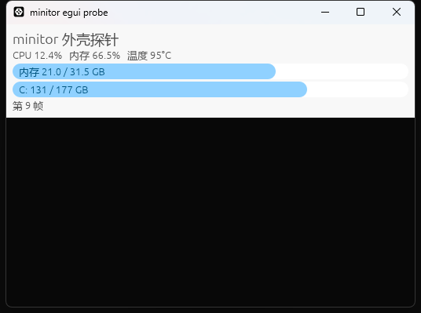

# 给 minitor 套前端壳：Tauri / Dioxus / egui / Leptos 选型分析

> 结论先行：**选 egui（eframe）**。它是四者里唯一"单进程、纯 Rust、无 WebView、无 Node 工具链"的方案，与现有零依赖内核同构；代价是约 **79 MB 内存 / 0.3–0.5 % 单核 / 4.3 MB exe**。
> 如果后续更看重"网页级观感 + 托盘 + 安装包 + 未来跨平台"，再换 **Tauri 2**，但要接受 2–4 倍内存与一套 Web 构建链。Dioxus 桌面端与 Tauri 同属 WebView 重量级却更不成熟；Leptos 根本不是桌面壳，要窗口仍得套 Tauri。

分析日期：2026-11-18。实测环境：Windows 11 26200 / Intel Ultra 7 155H（16C22T）/ 32 GB / NVMe。

---

## 1. 先厘清：这四个东西不在同一层

很多横评把它们并列打分，其实定位不同：

| 名字 | 是什么 | 用来做桌面窗口的方式 |
| --- | --- | --- |
| **egui / eframe** | 立即模式 GUI 库 + 窗口壳 | 直接开原生窗口，GPU 绘制，单进程 |
| **Tauri 2** | 桌面应用框架 | Rust 后端 + **系统 WebView2**，前端任意 Web 栈 |
| **Dioxus** | 全栈 UI 框架（RSX） | 桌面端基于 **wry/WebView**；原生渲染器仍在实验阶段 |
| **Leptos** | Web 响应式框架 | **没有桌面端**，要窗口必须套 Tauri / wry |

所以严格说：Tauri 是"壳"，egui 是"库 + 轻壳"，Dioxus 桌面端是"壳 + 框架"，Leptos 只是"网页那一层"。拿 Leptos 和 Tauri 比"内存"没有意义——Leptos 的内存取决于它被装进什么壳里。

对 minitor 真正的问题是：

> 采样内核已经是一个 383 KB、6.8 MB 私有内存、0.2 % 单核的零依赖程序。
> **外壳愿意为"好看"付多少代价？**

---

## 2. 数据来源与方法

三类数据，分开标注，避免把别人的跑分当成自己的：

1. **本机实测**：我写了一个最小 egui 探针（`experiments/egui-probe/`，520×360 窗口、中文标题、两条进度条、1 Hz 重绘），同一套测量脚本量它的内存/CPU/启动/体积。这是唯一能代表"你这台机器 + 这种界面"的数据。
2. **公开横评**：Zenn 上 2026-08 的《15 种桌面 UI 框架内存实测》，同一个应用（图库/编辑器/万行表格/表单/画布 5 个模块）、macOS M1、**把 WebView 子进程一起计入**。它给的是"重负载峰值"，适合看**倍数关系**。
3. **官方/厂商口径**：Tauri 2 的空项目基线（第三方 2026-04 整理：空闲 50–100 MB、冷启 200–500 ms、包体约 3 MB）。

版本信息查自 crates.io（2026-11-18），因为这类项目版本变化很快：

| 项目 | 稳定版 | 预览版 | 累计下载 | 最近发布 |
| --- | --- | --- | --- | --- |
| egui / eframe | **0.37.0** | — | 3200 万 / 2530 万 | 2026-10-15 |
| tauri | **2.12.6** | 3.0.0-alpha.6 | 4563 万 | 2026-11-16 |
| dioxus | **0.7.10** | 0.8.0-alpha.3 | 379 万 | 2026-10-16 |
| leptos | **0.8.23** | 0.9.0-rc1 | 628 万 | 2026-10-31 |

注意：Tauri 3 与 Dioxus 0.8 都还在 alpha，Leptos 0.9 是 RC。**别把预览版写进长期项目**。

---

## 3. 本机实测：egui 的真实代价

同一个探针，只改重绘策略，各跑 20 秒取稳定段：

| 重绘策略 | 空闲 CPU（单核） |
| --- | --- |
| 纯事件驱动（不主动请求重绘） | 0.55 % |
| 每秒 1 帧（`request_repaint_after`） | 0.47 % |
| 每秒 1 帧 + 两条进度条 | 0.31 % |
| **每帧都请求重绘（默认心智模型）** | **99.9 %** |

前四行的差异在测量噪声内（±0.1–0.2 个百分点），但最后一行说明：**egui 的空闲开销完全由"你是否让它一直重绘"决定**。很多 egui 应用"风扇狂转"就是栽在这里——默认按 60 fps 连续重绘，一个监控面板根本不需要。

稳定状态下的整套数据：

| 指标 | minitor TUI（现状） | egui 探针（本机实测） | 倍数 |
| --- | --- | --- | --- |
| 私有内存 | 6.8 MB | **78.6 MB** | 11.6× |
| 工作集 | 15.4 MB | 92–107 MB | ~6× |
| 空闲 CPU | 0.21 % | **0.31–0.55 %** | 1.5–2.6× |
| exe 体积 | 383 KB | **4.32 MB** | 11× |
| 启动到窗口 | 0.2 s | **0.25–0.5 s（中位 0.27 s）** | 1.4–2.5× |
| 进程 / 线程 | 1 / 4–8 | 1 / 11 | — |
| 第三方依赖 | 0 | eframe + egui + winit + glow… | — |

其中约 **25 MB 来自中文字体**：egui 内置字体没有 CJK 字形，必须把 `C:\Windows\Fonts\msyh.ttc` 读进来做字形图集（Zenn 的横评也观察到 egui/iced 因为 CJK 字体多出约 25 MB）。纯英文界面可以降到 ~55 MB。



*（探针实拍：中文渲染正常；这是默认浅色主题、未做任何样式打磨，能看出 egui 的观感基线。）*

作为对照，Zenn 的重负载峰值（含 WebView 子进程）：

| 框架 | 峰值内存 |
| --- | --- |
| Slint | 130–133 MB |
| **egui** | **155–157 MB** |
| iced | 155–177 MB |
| Electron | 512–644 MB |
| **Tauri** | **687–739 MB** |

倍数关系很稳定：**WebView 系大约是原生 Rust GUI 的 4–5 倍**。Tauri 官方口径的"空项目 50–100 MB"对比 egui 空项目，也是在 1.5–2 倍量级——真实应用里差距只会更大。

---

## 4. 逐个分析

### 4.1 egui / eframe —— 唯一"和内核同构"的选项

**架构**：立即模式（每帧重建 UI），无保留控件树，无 JS，无 IPC，无子进程。eframe 负责 winit 窗口 + glow(OpenGL)/wgpu 渲染。

**对 minitor 的意义**：
- `Sampler`、`Model`、`Snapshot` 直接 `use`，零序列化、零拷贝（或在 Arc 后面共享）。TUI 和 GUI 复用同一套 `ui::style` 语义（颜色、阈值）。
- 采样线程 + `Arc<Mutex<Arc<Snapshot>>>`，UI 每秒取一次；采样耗时 0.25–0.35 ms，不会卡帧。
- 没有 Node、没有 pnpm、没有前端构建产物；`cargo build --release --features gui` 一步出包。

**代价**：
- 内存从 6.8 MB 涨到 ~79 MB（其中 25 MB 是中文）。
- exe 从 383 KB 涨到 4.3 MB。
- 观感上限明显低于 Web：排版靠手工 `ui.horizontal`，图表要自己用 `Painter` 画（但火花线只要 `Shape::line`，不需要 `egui_plot` 这类额外依赖）。
- 没有托盘、安装包、自动更新。托盘要引 `tray-icon`，自启写注册表，安装包用 NSIS/WiX——都得自己补。
- 首次编译 eframe 依赖树约 50 秒（本机），之后增量很快。

**必须踩对的坑**：
1. 永远用 `request_repaint_after`，不要 `request_repaint` 每帧。
2. 中文字体一次加载，别每帧 `set_fonts`。
3. 高分屏/远程桌面下 OpenGL 可能建不出上下文；要么给 `wgpu` 后端，要么捕获错误后提示用 TUI。
4. 默认浅色主题和 TUI 的深色气质不一致，需要 `set_visuals(Visuals::dark())` 并自定义配色。

### 4.2 Tauri 2.12 —— 观感与桌面能力最强，但这是另一种物种

**架构**：Rust 主进程 + 系统 WebView2 子进程；前端任意（React/Svelte/纯 HTML 都行），通过 `invoke` 调 Rust 命令。

**资源**（第三方口径 + 官方基线）：空项目空闲 50–100 MB，冷启 200–500 ms，exe ~3 MB；重负载峰值 690 MB 以上（Zenn）。

**对 minitor 的两种接法**：
- **贴近**：Tauri 的 Rust 侧直接 `use minitor_core`，UI 通过 command 拿快照。少一层 IPC，但 GUI 和采样同生共死。
- **解耦（推荐）**：内核继续提供 `--serve`（本地 HTTP + SSE/JSON），Tauri 只是客户端。GUI 崩溃/重载不影响采样；将来手机/局域网看板也能复用同一接口。

**真正的优势**：
- 界面表现力：CSS、图表库（ECharts）、动效，随便做到"商业软件"水准。
- 桌面集成开箱即用：托盘、开机自启、单实例、自动更新、MSI/NSIS 安装包、能力（capability）权限模型。
- 包体小（3 MB 级），不像 Electron 那样塞 Chromium。

**真正的成本**：
- 一套 Web 工具链（Node/pnpm，或至少静态资源打包）。
- 两套构建、两套调试：Rust 侧和 JS 侧；WebView2 版本差异、IPC 调试都比单进程麻烦。
- 内存/启动比 egui 高一个档；一个"监控小面板"付这个代价，性价比存疑。

### 4.3 Dioxus 0.7.10 —— 桌面端等于"又一个 Tauri"，但成熟度更差

**架构**：RSX 组件（像 React），web/desktop/mobile 一套代码。**桌面端是基于 wry/tao 的 WebView 渲染**，和 Tauri 同一类开销；官方还在推进 Blitz 原生渲染器，但仍是实验性质。

**优点**：单语言全栈、组件模型顺手、热重载体验不错、以后想上移动端有路径。

**对 minitor 的问题**：
- 桌面端不会比 Tauri 省内存，却要承担 0.8 还在 alpha 的 API 波动（当前稳定 0.7.10）。
- 生态与资料量远小于 Tauri（下载量 379 万 vs 4563 万，差一个数量级）。
- 出了问题要穿透到 wry/WebView，排查成本和 Tauri 一样，但社区答案更少。
- 为了一个"看资源占用"的面板引入 RSX 全家桶，收益不成立。

**什么时候选它**：你已经用 Dioxus 写别的应用、团队熟悉 RSX、并且计划同时上移动端。否则不建议。

### 4.4 Leptos 0.8.23 —— 它不是壳

**架构**：细粒度响应式的 Web 框架（CSR/SSR/hydration），编译成 WASM 或服务端渲染。**没有桌面窗口能力**；Tauri 官方文档里 Leptos 是"前端框架"的一个选项。

**如果一定要用**：minitor 起一个本地 HTTP 服务，Leptos 编成 WASM 由浏览器加载。产物小（WASM 几百 KB）、开发体验好，但运行时仍然是浏览器标签页（80–150 MB 级别），并且需要 `trunk` + `wasm-bindgen` 工具链。

**结论**：把它当"网页层"来选是合理的；当"前端壳"来选是错位的。就本项目而言，一个手写 HTML + 现有 JSON 接口的收益/成本比更高。

---

## 5. 横向对照

权重按本项目的取向设定（**资源优先**，其次是与零依赖内核的契合度）：

| 维度 | 权重 | egui | Tauri 2 | Dioxus | Leptos（需套壳） |
| --- | --- | --- | --- | --- | --- |
| 常驻资源（内存/CPU/体积） | 30 % | 4 | 2 | 2 | 2 |
| 与零依赖内核的契合度 | 20 % | 5 | 3 | 3 | 2 |
| 界面表现力 | 20 % | 3 | 5 | 4 | 5 |
| 构建/发布复杂度（越低越好） | 15 % | 5 | 2 | 2 | 2 |
| 成熟度与长期维护 | 10 % | 4 | 5 | 2 | 3 |
| 桌面集成（托盘/自启/安装包） | 5 % | 2 | 5 | 3 | 1 |
| **加权分（启发式）** | | **4.05** | **3.25** | **2.65** | **2.95** |

分数只是把上面的定性判断压成一行，别当精确结论。真正的决策点是两句：

1. 你要的是"一个能常驻、几乎不占资源的监控窗口" → **egui**。
2. 你要的是"一个看起来像商业软件的监控面板，愿意多花 2–4 倍内存" → **Tauri**。

---

## 6. 最优解：egui 外壳 + 零依赖内核 + TUI 保留

### 6.1 结构（增量改造，不动现有代码）

```
minitor/
├── Cargo.toml            # 增加 [features] gui + [[bin]] minitor-gui
├── src/
│   ├── lib.rs            # 新增：把 cli/metrics/ui/sys 暴露成库
│   ├── main.rs           # 现有 TUI/CLI，保持不变（默认零依赖）
│   └── gui/
│       ├── mod.rs        # eframe App：布局、面板、主题
│       ├── widgets.rs    # 仪表条/火花线/每核网格（Painter 手绘）
│       └── font.rs       # msyh.ttc 一次加载 + 失败降级
└── experiments/egui-probe/   # 本次实测用的最小探针（不参与主构建）
```

`Cargo.toml` 关键片段：

```toml
[features]
default = []
gui = ["dep:eframe"]

[dependencies]
eframe = { version = "0.37", optional = true, default-features = false, features = ["glow", "default_fonts"] }

[[bin]]
name = "minitor"
path = "src/main.rs"

[[bin]]
name = "minitor-gui"
path = "src/gui/main.rs"
required-features = ["gui"]
```

这样 `cargo build --release` 仍然产出**零依赖的 383 KB TUI**；只有显式 `--features gui` 才会拉 eframe。想更彻底就拆 workspace（`minitor-core` / `minitor-cli` / `minitor-gui`），但对当前体量是过度设计。

### 6.2 线程与数据流

```
采样线程 ──每 1 s──> Arc<Snapshot> ──Mutex 存放──> GUI 线程（eframe/egui）
     │                                                  │
     └── 与 TUI 共用同一个 Sampler ──────────────────────┘  1 Hz request_repaint_after
```

- 采样放后台线程（`std::thread`），主线程只做 UI；采样抖动不会卡动画。
- 用 `Arc<Snapshot>` 而不是克隆整个结构：UI 每帧只取指针。
- GUI 退出不影响采样线程的清理（进程一起退出即可）。

### 6.3 关键实现约束（决定成败的四点）

1. **重绘**：`ctx.request_repaint_after(Duration::from_secs_f64(interval))`，全程序不出现无条件的 `request_repaint()`。按实测，这是 0.4 % 和 100 % 的区别。
2. **字体**：启动时读一次 `msyh.ttc`（或 `msyhl.ttc`），失败就退回英文标签；不要把字体塞进二进制（+19 MB）。
3. **主题**：`Visuals::dark()` + 复用 TUI 的 256 色调色板，两个界面气质一致；`--theme light` 同样映射。
4. **布局**：按 TUI 的分区重建——CPU（总条 + 火花线 + 每核格）、内存、磁盘（每卷）、网络、散热/电池、自身开销；用 `egui::Grid` 对齐，窗口最小 720×480，可缩放。

### 6.4 验收标准（把"低开销"变成可测指标）

| 指标 | 目标 | 测量方式 |
| --- | --- | --- |
| 私有内存 | ≤ 85 MB（含中文字体） | `Get-Process` / 程序内 `--bench` |
| 空闲 CPU（1 Hz） | ≤ 0.6 % 单核 | 30 秒 `$p.CPU` 增量 |
| exe 体积 | ≤ 5 MB | 资源管理器 |
| 启动到窗口 | ≤ 0.8 s | 秒表 / `MainWindowHandle` 轮询 |
| 采样开销 | 与 TUI 相同（250–350 µs/tick） | 复用 `--bench` |

达成这五条，就保住了"极低资源消耗"的产品前提；否则说明某个环节（多半是重绘或字体）出问题了。

### 6.5 建议的落地顺序

1. **抽库**：`lib.rs` 暴露 `Sampler` / `Model` / `Snapshot` / 主题色；TUI 行为不变，测试全绿。
2. **骨架**：eframe 窗口 + 1 Hz 重绘 + 6 个面板的静态布局，先接 `--once` 的同一份快照。
3. **接入采集**：后台采样线程 + Arc 共享；把 `--bench` 的指标搬到 GUI 的"自身"面板。
4. **打磨**：中文、深色、DPI、窗口尺寸记忆（可选，`persistence` 会引入 `ron` 依赖，能省则省）、托盘（`tray-icon`，可选）。

按这个顺序，每一步都可运行、可回退；第 2 步结束时就能判断 egui 的观感是否可接受——这是整个决策里唯一"数据给不了答案"的部分。

---

## 7. 什么时候应该改选 Tauri

出现下面任意两条，就应该选 Tauri 而不是 egui：

- 需要**托盘常驻 + 开机自启 + 安装包/自动更新**（egui 都得自己补，Tauri 开箱）。
- 需要**网页级观感**：图表库、动画、精细排版、响应式布局。
- 计划**跨平台**（macOS/Linux），或以后想在手机/局域网浏览器上看同一套面板。
- 团队本来就在写前端，Rust 只是后端。
- 可以接受 ~150 MB 级内存与 Node 工具链。

在这个分支里，**推荐把 GUI 做成独立客户端**（读内核的 `--serve` HTTP/SSE），而不是把采样塞进 Tauri 主进程：监控进程最忌讳被 UI 拖累，解耦之后 GUI 崩了也不影响记录。

---

## 8. 不推荐 Dioxus / Leptos 的理由（一句话版）

- **Dioxus**：桌面端和 Tauri 一样重（WebView），却要承担 0.8 alpha 的 API 变动；除非你已经在用 RSX，否则没有理由。
- **Leptos**：它是 Web 框架，不是桌面壳；想要窗口还是得套 Tauri。若只是想要网页 UI，手写 HTML + 现有 JSON 接口比引入 `trunk`/`wasm-bindgen` 更划算。

---

## 9. 风险与回退

| 风险 | 影响 | 应对 |
| --- | --- | --- |
| OpenGL 上下文创建失败（远程桌面/老驱动） | GUI 起不来 | 捕获错误后提示改用 TUI；或编 `wgpu` 后端 |
| 中文字体缺失 | 豆腐块 | 检测字体文件；没有就切英文标签 |
| egui 版本升级 breaking | 编译失败 | 锁 `0.37`，升级时单独跑一遍视觉回归 |
| 内存/CPU 超标 | 违背产品前提 | 用 6.4 的指标做 CI 门槛（`--bench` 已能测采样侧） |
| 用户不想要 GUI | —— | GUI 是可选 feature，默认不编译；TUI 永远是默认入口 |

**回退方案始终存在**：TUI 不动，GUI 是增量的可选二进制。这一点比选哪个框架都重要。

---

## 10. 参考

- Zenn《デスクトップUIフレームワーク15種のメモリ使用量計測》（2026-08，同应用多模块、含子进程峰值）：<https://zenn.dev/mizugeeks/articles/1019cf2353d343>
- Tauri 2 与 Electron 对比（2026-04，hello-world 空闲 50–100 MB / 冷启 200–500 ms / 包体约 3 MB）：<https://blog.rajpoot.dev/posts/typescript/tauri-2-vs-electron-desktop-apps-2026/>
- Tauri 官方文档中的 Leptos 集成（说明 Leptos 是前端框架而非桌面壳）：<https://v2.tauri.app/start/frontend/leptos/>
- crates.io API（版本、下载量，查询于 2026-11-18）：<https://crates.io/api/v1/crates/egui>、<https://crates.io/api/v1/crates/tauri>、<https://crates.io/api/v1/crates/dioxus>、<https://crates.io/api/v1/crates/leptos>
- 本仓库实测探针与截图：`experiments/egui-probe/`、`docs/egui-probe.png`

> 附：文中 egui 的数值是本机实测（20 秒稳定段、窗口可见），Tauri/Dioxus 的数值来自上述第三方资料，未在本机复现——如果你的项目要严格对比，建议用 `experiments/egui-probe` 的同款方法各做一个最小壳再量一次。

---

## 11. 落地结果（2026-11-18 已实现）

探针之后，我按第 6 节的结构把 `minitor-gui` 真正做了出来（`cargo build --release --features gui`）。预估与实际的对照：

| 指标 | 探针预估 | 实际仪表盘 |
| --- | --- | --- |
| 私有内存 | 79 MB | 85 MB（多了六块卡片与更长的历史环） |
| 稳态 CPU | 0.31–0.55 % | 0.5–0.8 %（1 帧/秒） |
| exe | 4.32 MB | 4.6 MB |
| 首帧 | 0.19 s | 0.19 s |
| 默认构建 | 不受影响 | 不受影响：eframe 只在 `--features gui` 时编译 |

实现中验证了两条关键判断：

1. **重绘策略是决定性的**。`request_repaint_after(1s)` 下稳定 1 帧/秒、0.5–0.8 % 单核；而窗口获得焦点的瞬间会有一段约 1 秒的 60 帧/秒重绘（自测 CPU 会短暂跳到 20 % 以上），随后回落。若让每帧都重绘，单核会被吃满——探针里实测就是 99.9 %。
2. **中文字体是最大的一笔内存**：带着 `msyh.ttc` 私有内存 85 MB，去掉后约 60 MB，代价是中文变豆腐块。

落地时踩到的坑（都已在代码里处理）：

- `eframe 0.37` 把 `App` trait 的 `update(&Context, &mut Frame)` 改成了 `ui(&mut Ui, &mut Frame)`；
- `Context::style()/set_style()` 已被 `all_styles_mut` / `set_style_of` 取代，切换深浅色要先 `set_theme` 再 `set_visuals`；
- `Id::new` 已废弃，改用 `Id::unique`；
- 用 `--light` 启动时，若把「已应用的主题」标志直接初始化为 `false`，首帧不会应用浅色控件样式，会出现「卡片浅色、按钮深色」的混合状态——必须让第一帧强制同步一次；
- 图表坐标轴要按卡片高度动态决定网格数量，否则矮卡片里 y 轴刻度会叠在一起。

报告里的架构建议被原样采用：核心库零依赖不变，`minitor-gui` 通过 library 直接读 `Sampler`/`Snapshot`，采样与渲染同进程，没有 IPC。