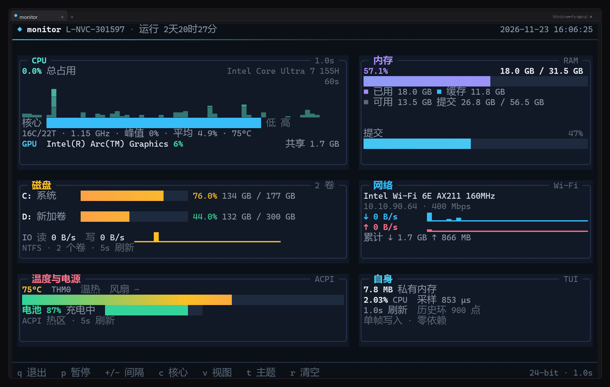
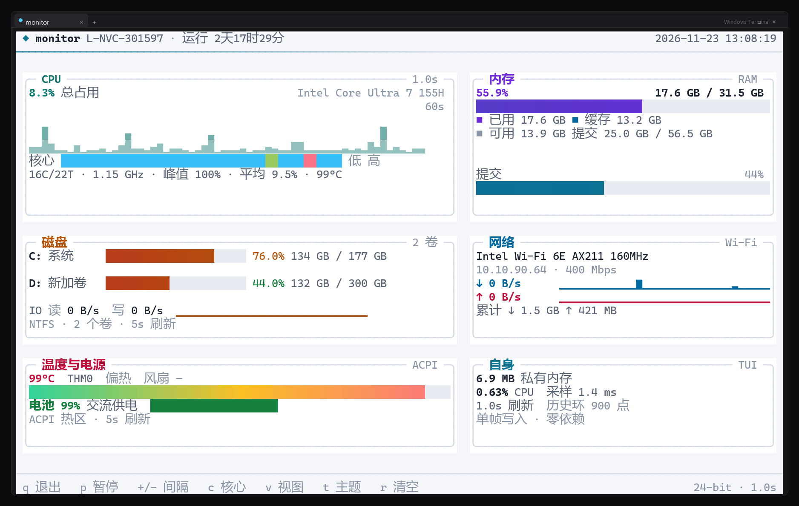

# 卡片仪表盘（默认视图）

日期：2026-11-23。设计确认：方向 **A · 控制室 Control Room**（三方向初稿保存在本地 `design-demos/tui/`，不随仓库分发）。从 2026-11-23 起，卡片视图是 `monitor` 的默认界面，`--classic` 可切回极简 TUI。



## 目标

在保留极简 TUI（`--classic`）的前提下，把卡片渲染器设为默认界面：

- 复用同一套 `Model` / `Sampler` / 历史环，采样与 1 Hz 主循环完全不变。
- 零第三方依赖；仍然是每帧拼成一个字符串、一次 `WriteConsoleW`。
- 24-bit truecolor 优先，256 色自动降级；窗口小于 100×30 时回退到极简 TUI。

## 界面结构

2 列 × 3 行卡片：

| 卡片 | 内容 |
| --- | --- |
| CPU | 大号总占用、60 秒面积趋势、22 个逻辑核热力条、峰值/平均/频率/温度、GPU 适配器与显存 |
| 内存 | 使用条、已用/缓存/可用、提交量与提交条 |
| 磁盘 | 每卷用量条与容量、读写速率与 IO 趋势、文件系统 |
| 网络 | 活动适配器、IPv4/链路速率、上下行速率与趋势、累计流量 |
| 温度与电源 | 最热 ACPI 热区、20–105 °C 渐变轨道、风扇、电池与供电状态 |
| 自身 | 私有内存、CPU、单次采样耗时、刷新间隔 |

顶部是 `◆ monitor`、主机名/开机时长与日期；底部保留 `q / p / +/- / c / v / t / r` 快捷键。`t` 同时切换深浅色，`v` 在极简与美化视图之间切换。

浅色主题：



## 颜色与降级

- 自动探测：`COLORTERM=truecolor|24bit` 或 Windows Terminal 的 `WT_SESSION` → 24-bit；否则使用 xterm-256 近似色。
- 强制模式：`--color 256` / `--color truecolor`。
- 布局下限：宽度 ≥ 100、高度 ≥ 30；更小的窗口自动走原极简渲染，不出现残缺卡片。
- 卡片背景会填充每个单元格；如果终端开了背景透明，美化模式下会盖住壁纸。

## 用法

```powershell
monitor                          # 默认卡片仪表盘（深色/浅色跟随 --theme）
monitor --classic                # 切回极简 TUI
monitor --theme light            # 浅色
monitor --color 256              # conhost / 不支持 24-bit 的终端
monitor --demo --width 120 --height 34   # 无终端输出纯文本布局，便于检查
```

TUI 内按 `v` 切换视图，按 `t` 切换深浅色。

## 实现

| 文件 | 改动 |
| --- | --- |
| `src/ui/fancy.rs` | 新增：调色板、`Grid` 单元格画布、卡片布局、面积图/仪表/热力条、测试 |
| `src/ui/style.rs` | `Color::True(r,g,b)`、`Style.bg`、24-bit/256 SGR、truecolor 探测 |
| `src/ui/mod.rs` | 挂载 `fancy` 模块 |
| `src/cli.rs` | `--classic` / `--fancy`、`--color auto|256|truecolor`（默认卡片视图） |
| `src/main.rs` | TUI 渲染分派、`v`/`t` 快捷键、`--demo` 卡片布局 |
| `tests` | 新增宽度/高度/256/truecolor/浅色测试 |

渲染仍是一个单元格网格（宽度精确、CJK 占 2 列、宽字符跨边界保护），直接把网格转成既有的 `Line`/`Span` 再序列化；没有引入新的终端写入路径。

## 验证

- `cargo test`：**68 passed**（美化布局、24-bit/256 输出、浅色主题、GPU/进程采集、CLI 解析等新增测试在内）。
- 发行版二进制：**520,192 字节（约 508 KB）**；增加的是渲染与 GPU 采集代码，CPU/内存采样路径未变。
- 截图由真实 `monitor` 采样帧渲染（60 秒历史 + 一次 CPU 负载），不是设计稿。

## 已知限制

- 方块与圆角字符依赖终端字体；Windows Terminal + Cascadia 系列正常。极少数 SSH/老终端可能出现边框错位。
- 卡片视图是默认界面；如果终端不支持方块/圆角字形或窗口过小，可用 `--classic` 回到极简 TUI。
- 背景色填充意味着不能透出终端壁纸/亚克力背景。
